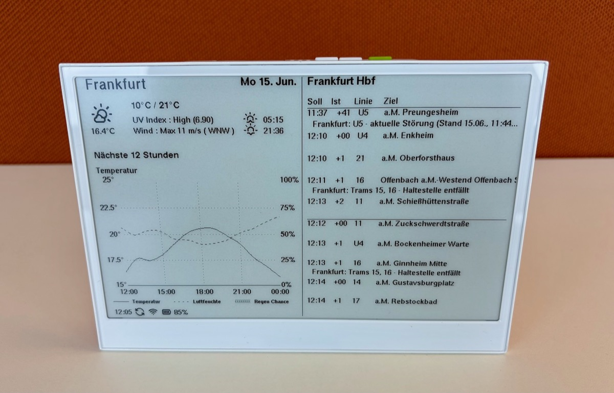

# MyStation

> ESP32-powered e-paper display showing real-time German public transport departures (RMV) and weather (DWD).

[](https://platformio.org/)
[](https://www.espressif.com/en/products/socs)
[](https://www.gnu.org/licenses/lgpl-3.0)



---

## ⚠️ Project status: maintenance only

**Active feature development has stopped.** The project is considered feature-complete and is now
in **maintenance mode** — only **bug fixes** are planned. New feature requests are generally out of
scope, though pull requests are still welcome. Expect slower responses.

---

## What it does

- 🚌 Real-time departures from German public transport (RMV)
- 🌤️ Weather and forecast from the German Weather Service (DWD, via Open-Meteo)
- 🔘 Three physical buttons to switch display modes and browse the forecast
- 🔋 Deep sleep for months of battery life
- 📱 Web-based configuration (no app needed)
- 🔄 Over-the-air (OTA) firmware updates

## Display modes

- **Half & Half** — weather + departures side by side
- **Weather Only** — full-screen weather, with multi-day forecast browsing
- **Departures Only** — full-screen departure board

## Hardware

- ESP32-C3 or ESP32-S3 board (buttons & battery monitoring: ESP32-S3 only)
- 7.5" e-paper display (GDEY075T7, 800×480)
- 2.4 GHz WiFi (5 GHz not supported)
- Optional 3.7V LiPo battery

See **[Hardware Assembly](./docs/developer-guide/hardware-assembly.md)** for wiring.

## Quick start

```bash
git clone https://github.com/gogo-boot/mystation.git
cd mystation

# API keys (Google Geolocation, RMV) — see the API guide below
cp include/secrets/general_secrets.h.example include/secrets/general_secrets.h

# Build + flash (PlatformIO)
pio run --target upload
pio device monitor
```

Then power on, connect to the `MyStation-XXXXXXXX` WiFi hotspot, open the config page, and set your
WiFi, stop, and preferences.

## Documentation

- 📖 **[Developer Guide](./docs/developer-guide/index.md)** — architecture and internals
- ⚙️ **[Development Setup](./docs/developer-guide/development-setup.md)** — build environment
- 🔑 **[API Integration](./docs/developer-guide/api-integration.md)** — Google / RMV / DWD keys
- 🔘 **[Button System](./docs/developer-guide/button-system.md)** — modes & forecast browsing
- 🎨 **[Display System](./docs/developer-guide/display-system.md)** — e-paper layouts
- 🧪 **[Testing](./docs/developer-guide/testing.md)** — native unit tests
- 📋 **[Run Book](./docs/developer-guide/run-book.md)** — common commands & troubleshooting

## Common commands

```bash
pio run                              # build (default env)
pio run -e esp32-s3-e1001-debug -t upload   # build + flash debug
pio device monitor                   # serial monitor
pio test -e native                   # run unit tests
```

## Coverage

- **Transport:** Hesse, Germany (RMV — Frankfurt, Wiesbaden, Kassel, Darmstadt, …)
- **Weather:** Germany and surrounding areas (DWD via Open-Meteo)

Adaptable to other regions/APIs — see the [API Integration guide](./docs/developer-guide/api-integration.md).

## License

Licensed under the **GNU Lesser General Public License v3.0 (LGPL-3.0)**. You may use, modify, and
distribute it; modifications to this code must remain under LGPL-3.0, and linking from proprietary
applications is permitted. See [LICENSE](LICENSE) for the full text.

Third-party libraries: GxEPD2 (GPL-3.0), ArduinoJson (MIT), WiFiManager (MIT),
ESPAsyncWebServer (LGPL-3.0), U8g2 (BSD).
